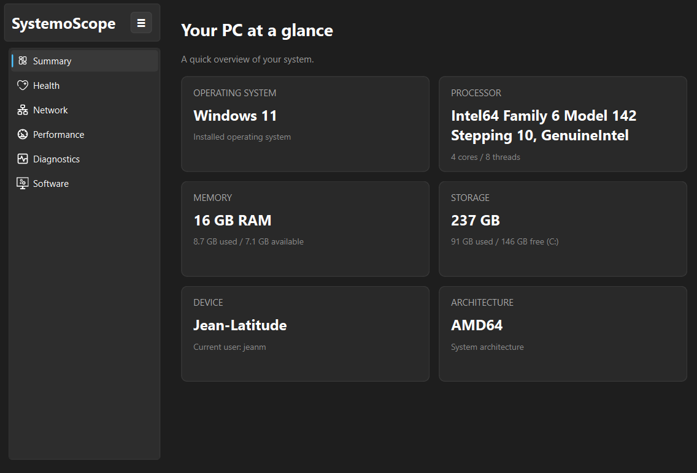

# SystemoScope



## What i built

SystemoScope is a desktop system monitoring application built with Python. It acts like a stethoscope for your computer, giving you a look at its hardware, resource usage, health, and overall system. 

## Features

- System Summary
- System Health
- Network Status
- Performance Enhancement & Debloating
- Diagnostics
- Software Manipulation

*Some system metrics can also be visualized using graphs.

## Built With

- Python
- PySide6
- psutil (system and process information)
- PyQtGraph (real-time data visualization)

## Install and Try SystemoScope

### 1. Requirements
- Python
- pip

### 2. Installation
#### 1. Clone Repository or download master:
``` 
git clone https://github.com/itsjeanxx12/SystemoScope.git
cd SystemoScope
```
#### 2. Install the dependencies:
```
pip install -r requirements.txt
```
#### 3. Run the application:
```
python main.py
```

*An executable will be available on the first release

## About the name
SystemoScope combines System and Stethoscope. Just as a stethoscope helps examine the human body, SystemoScope helps examine your computer.


