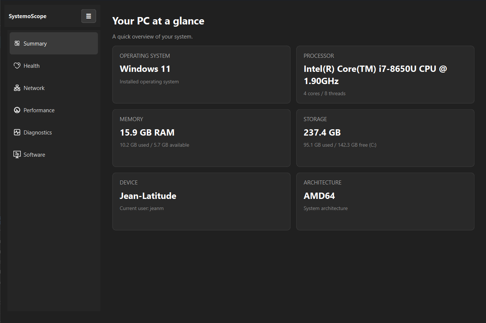
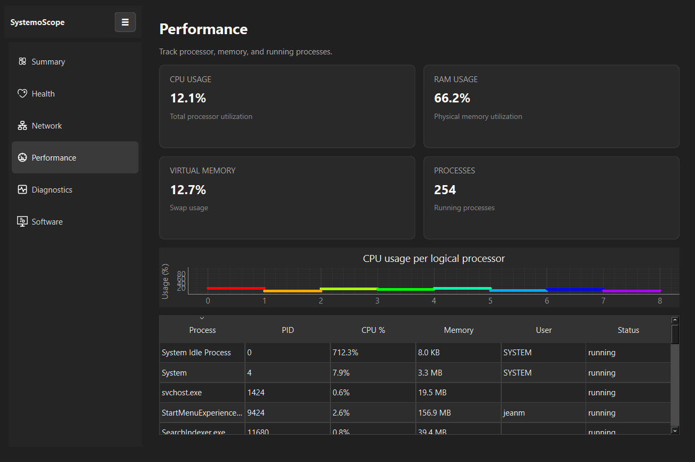

# SystemoScope

SystemoScope is a lightweight system monitor that lets you see all of your system metrics in one place! Check your PC's health, uninstall apps, run checks, all in one place.

## Description and Features

SystemoScope lets you see your hardware **Summary** : os, cpu, ram, storage, ... ; **Health**, which contains battery status and health (if on a laptop), CPU/GPU temperatures, fan speeds, RAM - CPU - Disk usages, and CPU temperature history graph. On the **Network** side, it shows live up/down rates, total traffic, and network adapter info. For **Performance**, it's like the task manager, showing CPU usage, memory, with a live process list. You can also **Diagnose** your CPU, memory, storage, battery, and temperature sensor checks for availability. In **Software**, you can see every piece of software thats on your PC.

Overall, **SystemoScope** is an all-in-one tool that is like a stethoscope for your PC.

## Screenshots

**Summary Page:**

**Performance Page:**

## Getting Started

### Dependencies

- Windows 10 or Windows 11
- LibreHardwareMonitor (https://github.com/LibreHardwareMonitor/LibreHardwareMonitor) Run the web server in LHMonitor: **Options → Remote Web Server → Run** and keep it running, it can be minimized to tray.

## Installation

Install **SystemoScope.exe** from the release page.
Install LibreHardwareMonitor either from this repo by downloading master, or the official repo (https://github.com/LibreHardwareMonitor/LibreHardwareMonitor)
Run the web server in LibreHardwareMonitor: **Options → Remote Web Server → Run** and keep it running, it can be minimized to tray.
Run **SystemoScope.exe**, preferably as administrator.

## License
This project is licensed under the MIT License - see the LICENSE.md file for details
